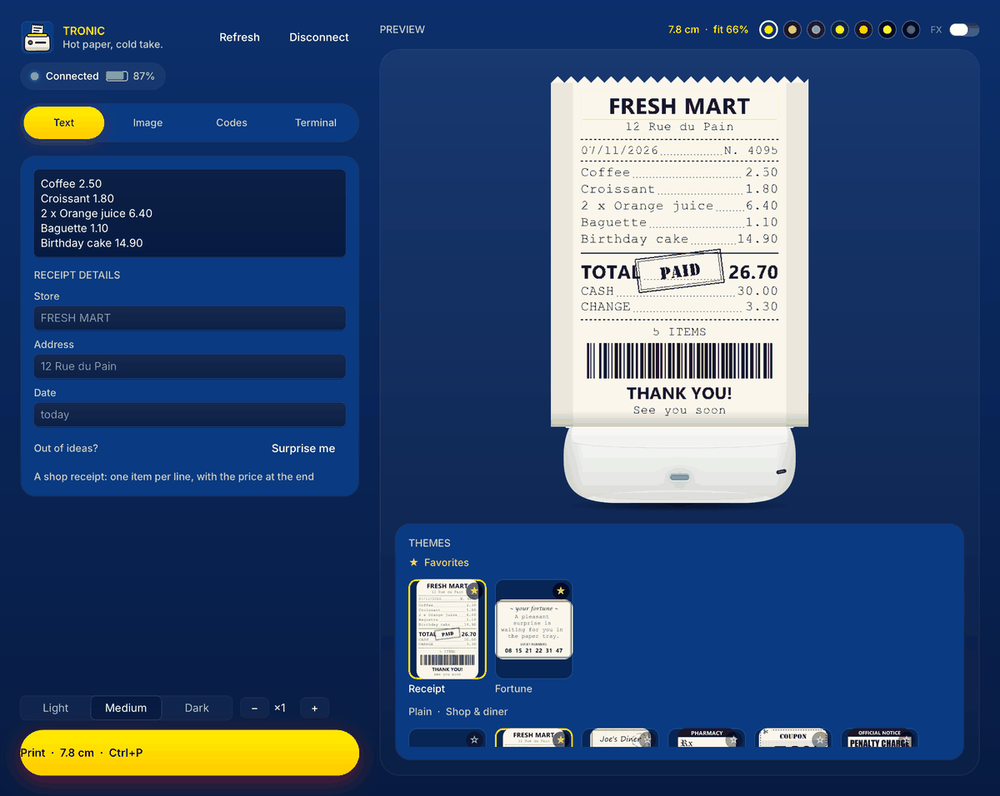
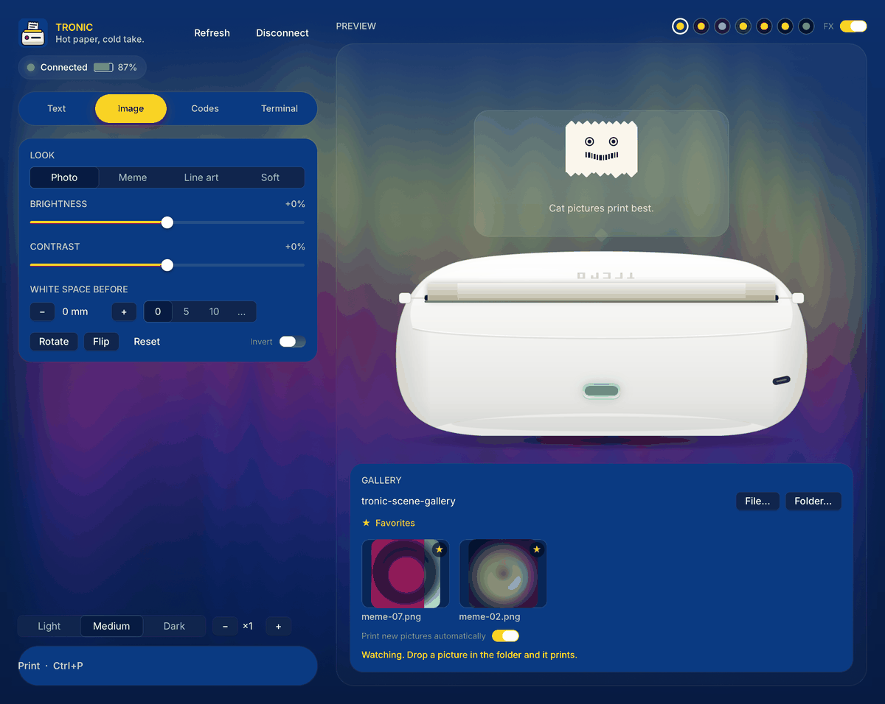
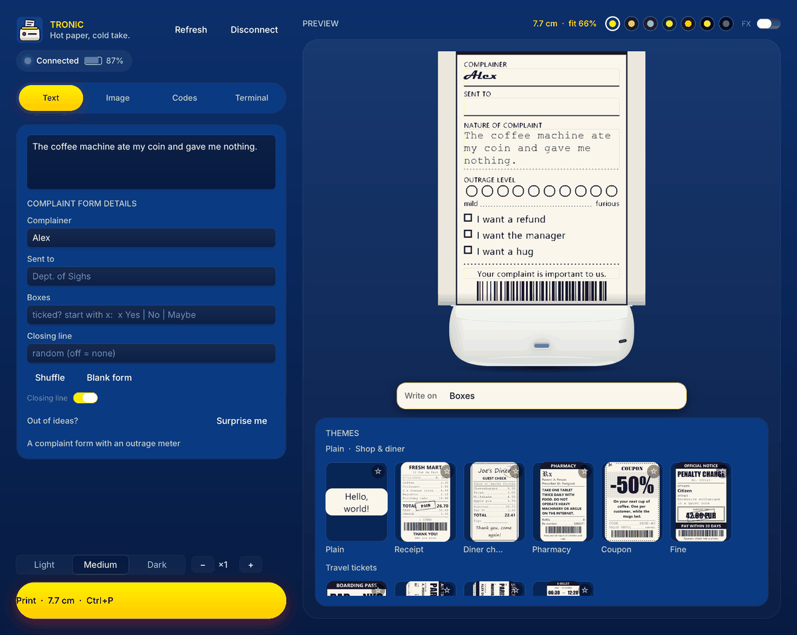
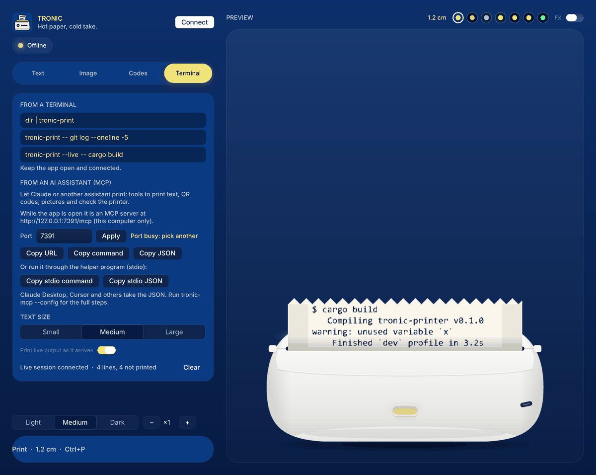
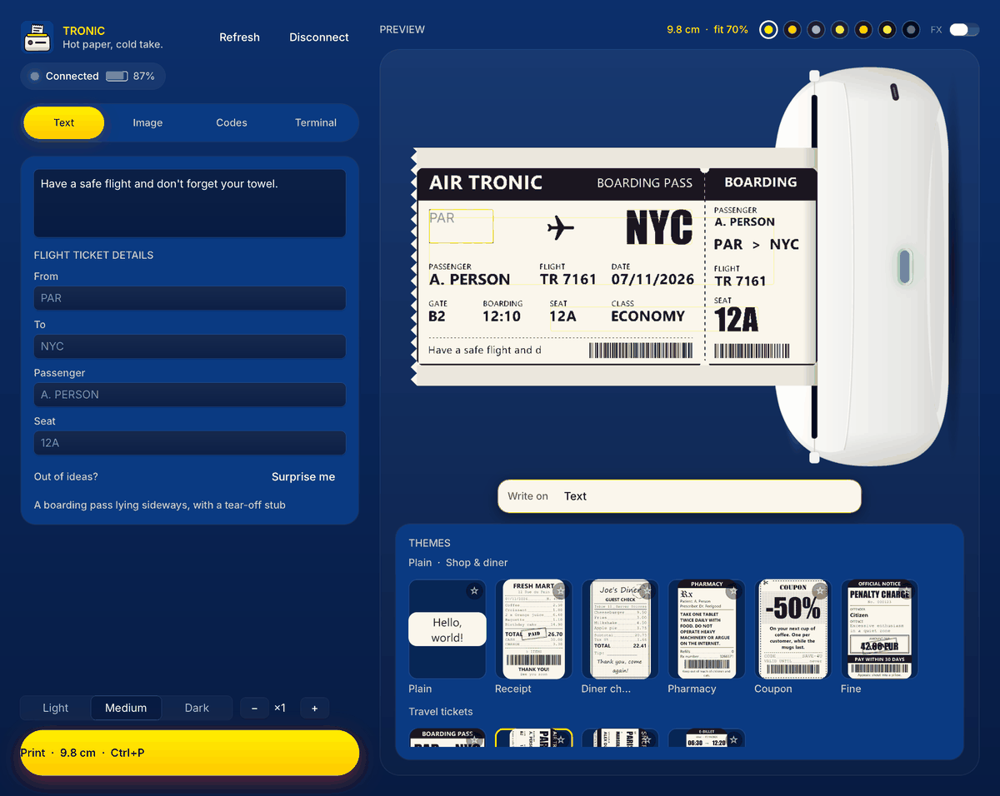
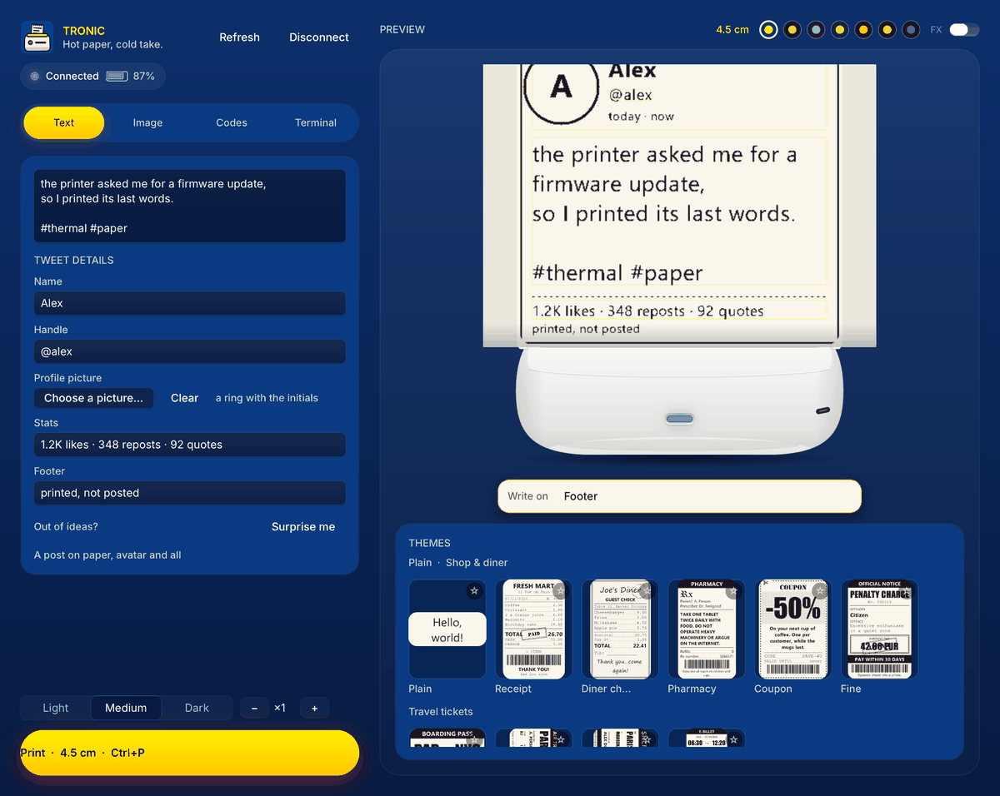

# Tronic Printer

Print from Windows on the **Lidl Tronic / Silvercrest "Mini Pocket Printer"** (model 5890, firmware
`V1.06LY`) over Bluetooth LE. A small Rust app with a [Rune](https://github.com/anomalyco/rune) GPU
interface: text, pictures, QR codes and barcodes, a picture gallery that prints by itself, terminal
output, and an MCP server so an AI assistant can print too.

The Bluetooth protocol comes from [dimer47/PocketPrinter5890](https://github.com/dimer47/PocketPrinter5890)
and was checked on a real unit.



## Build and run

You need Rust and the *Build Tools for Visual Studio* (C++ workload). Then:

```powershell
cargo build --release
.\target\release\tronic-printer.exe
```

Use the release build for daily use: the debug build is much slower (sliders, effects). The build
makes three programs next to each other in `target\release`:

| Program | What it is |
|---|---|
| `tronic-printer.exe` | the app (window) |
| `tronic-print.exe` | prints terminal output through the running app |
| `tronic-mcp.exe` | MCP server for hosts that run a command (stdio; the app itself also serves MCP over HTTP, see below) |

Switch the printer on, close its phone app (it only talks to one device at a time) and open the
app: it connects by itself. Windows 11 is recommended (dark title bar, round corners).

## In the app

- **Text**: five fonts, four sizes, alignment, white on black, and "Surprise me". Or pick a **theme**
  (below): the same text as a shop receipt, a parchment scroll, a boarding pass…
- **Image**: pick a folder as a gallery (scrolls, thumbnails), click a picture, or **drag it onto the
  printer** to preview it. Look (Photo, Meme, Line art, Soft), brightness and contrast sliders, rotate,
  flip, invert, and "White space before" (0 to 50 mm of blank paper above the picture).
  "Print new pictures automatically" prints pictures you add to the folder; pictures
  dropped on the window from Explorer are shown on the preview, ready to print.
- **Codes**: QR, Code 128, Code 39, EAN-13.
- **Terminal**: see below.
- A live preview of the exact black and white ticket, darkness, copies. The **FX** switch turns the
  GPU effects (fire, plasma, smoke, ghost paper) on or off; it starts off when Windows animations
  are disabled. Next to it sits a row of chips for the seven colour palettes — **Discount** (the
  default), Night, Professional, Christmas, Halloween, Terminal, Matrix — and the choice is kept
  for the next runs.
- **Ctrl+P** prints, whatever is focused; it works while you are typing in a box.

## Screenshots

All of these are rendered by the app itself with `--snap` (no window, no printer).



*The **Image** tab: a folder shows up as a gallery of thumbnails; the picture you pick goes on the
printer.*



*A silly form: the parts you can write on are outlined on the ticket, and the bar under it picks a
part to type on.*



*The **Terminal** tab: the `tronic-print` commands, the MCP port, and buttons that copy the URL and
the JSON.*



*The `flight` theme: a boarding pass lying sideways with its tear-off stub.*



*The `tweet` theme: name, handle, avatar, text and numbers, printed on paper.*

## Writing themes

A theme dresses your text as a document, drawn for the printer's 384 black-and-white dots: fonts,
borders, rules, stamps, barcodes, speckle. Pick one in the gallery under the preview (the preview
shows it as you type); themes with details (a store name, a seat number) show a small form. Parts
of the ticket you can write on are outlined on the preview: click one and a text box opens right
on the paper (a part a theme draws in a way that cannot be read back is typed in a slim bar under
the ticket instead). The **gallery** shows a small picture of every ticket: click one to use it, or
pull it onto the printer to print your text in that theme.

| Family | Themes (id, details) |
|---|---|
| (no family) | `plain` — your text as typed, no decoration |
| Shop & diner | `receipt` (store, address, date: one `Item 2.50` per line, the total is added), `diner` (place, table, server), `pharmacy` (patient, doctor, refills), `coupon` (offer, code, expires), `fine` (offender, amount, number) |
| Travel tickets | `boarding` (from, to, name, seat), `flight` (same, lying sideways like a real boarding pass with a tear-off stub), `train-old` (the classic card ticket with its magnetic strip: from, to, date, seat; the text is the passenger), `train` (the e-ticket with a QR code: same fields) |
| Parchment & old world | `parchment` (title, signed), `decree` (title, signed), `wanted` (name, reward), `treasure` (place) |
| Fun official papers | `movie` (room, seat, time), `fortune`, `diploma` (name, award, signed), `horoscope` (sign, symbol), `fridge`, `checklist` (title), `ransom`, `name-tag`, `font-salad`, `tweet` (name, handle, avatar, stats, footer), `banner` (font) |
| Silly forms | `while-out` (to, from, time, boxes, footer), `permission` (name, by, boxes, footer), `incident` (by, place, date, boxes, footer), `passive` (to, from, footer), `pep` (name, footer), `excuse` (who, by, boxes, footer), `complaint` (name, dept, boxes, footer), `apology` (to, from, boxes, footer), `iou` (from, to, due, boxes, footer), `review` (name, period, boxes, footer), `butthurt` (user, provider, model, boxes, footer) |
| Techy & retro | `terminal` (prompt), `dot-matrix` (title), `label`, `telegram` (to), `punch-card`, `poster` |

That is 42 built-in themes; your own JSON themes (see `themes/README.md`) come after them.
A silly form prints mostly blank so you can fill it in by hand: the boxes are never ticked for you,
and the form offers **Shuffle**, **Blank form** and a **Closing line** switch.

Lines starting with `- `, `* `, `x `, `[ ]` or `[x]` become tick boxes in `checklist` and `fridge`.
Fonts come from Windows; a theme falls back to a plainer font if one is missing.

```powershell
'Coffee 2.50', 'Croissant 1.80' | tronic-print --theme receipt --field store="CAFE LUNE"
'Dig where the shadow ends' | tronic-print --theme treasure --field place="Skull Island"
```

An assistant uses `print_text` with `theme` and `fields`, e.g. *"print a boarding pass from LYS to
BCN for Alex"*.

## From a terminal

Keep the app open and connected.

```powershell
dir | tronic-print                        # print what arrives, once
tronic-print -- git log --oneline -5      # run a command and print its output
tronic-print --live -- cargo build        # print as the output arrives
tronic-print --force ...                  # allow more than 100 cm for one print
tronic-print --theme receipt --field store=SHOP   # dress the text as a document (see Writing themes)
```

## From an AI assistant (MCP)

Keep the app open and connected (wait until the app says **Connected**); the server talks to the
running app.

There are two ways in:

- **HTTP, no helper program**: while the app is open it is itself an MCP server at
  `http://127.0.0.1:7391/mcp` (this computer only). The port is set in the app's **Terminal** tab
  or with the `TRONIC_MCP_PORT` environment variable. Any host that takes a URL can use it, and
  your own programs can POST JSON-RPC to it.
- **stdio**: `tronic-mcp.exe`, an [MCP](https://modelcontextprotocol.io) server over stdio, for
  hosts that run a command.

**Tools** (both ways)

| Tool | What it does |
|---|---|
| `print_text` | text, with `font`, `size`, `align`, `invert`, `copies`, or a `theme` (receipt, parchment, boarding…) with its `fields` |
| `print_code` | QR code or barcode (`type`: qr, code128, code39, ean13), with `caption`, `error_correction` |
| `print_image` | a picture file on this PC (`path`), with `look`, `brightness`, `contrast`, `rotate`, `flip`, `invert`, `space_before_mm` (0 to 50 mm of blank paper above the picture) |
| `printer_status` | connected or not, battery, model, firmware, busy |

Anything over 100 cm of paper needs `force: true`, to protect the roll.

`tronic-mcp --config` prints these instructions with the right paths for your machine, and the app's
**Terminal** tab has buttons that copy the URL, the commands and the JSON (HTTP and stdio).

### Claude Code

```powershell
claude mcp add tronic-printer -- "C:\path\to\tronic-mcp.exe"          # stdio
claude mcp add --transport http tronic-printer http://127.0.0.1:7391/mcp   # or HTTP
```

Check with `claude mcp list`, then ask: "print a QR code for https://example.com".

### Claude Desktop

Settings > Developer > Edit Config, add to `claude_desktop_config.json`, then restart Claude Desktop:

```json
{
  "mcpServers": {
    "tronic-printer": {
      "command": "C:\\path\\to\\tronic-mcp.exe",
      "args": []
    }
  }
}
```

### Cursor, Windsurf, VS Code, Cline and others

Add a stdio MCP server with the same JSON (the file is usually `mcp.json`, or the `mcp` section of the
settings), or give the host the command `C:\path\to\tronic-mcp.exe` with no arguments. Hosts that
take a URL use `http://127.0.0.1:7391/mcp` instead (the JSON has a `"url"` key, no `"command"`).

### Check it by hand

```powershell
'{"jsonrpc":"2.0","id":1,"method":"tools/call","params":{"name":"printer_status","arguments":{}}}' | .\tronic-mcp.exe
```

The same line POSTed to `http://127.0.0.1:7391/mcp` answers the same way, with the app running.

## Troubleshooting

- **"the Tronic Printer app is not running"**: open the app and wait for **Connected**.
- **Printer not found**: switch it on, close its phone app, turn the phone's Bluetooth off, and keep
  it within a metre or two of the PC (the Wi-Fi/Bluetooth antenna must be plugged in on a desktop).
- **Nothing prints but it answers**: check the paper (thermal side facing the head) and the lid.

## Developing

```powershell
cargo test                                  # unit tests for every part
cargo run -- --snap out.png --scene text    # render the window headless, no Bluetooth; scenes:
                                            # text, online, gallery, drag, printing, ghost, ghost-online,
                                            # look, connecting, done, egg, error, qr, image, terminal,
                                            # theme, form, butthurt, tweet, salad, write, write-receipt,
                                            # write-parchment, write-diploma, write-flight, write-wanted,
                                            # write-banner
.\tools\qa.ps1                              # build release and open the QA copy (run\tp-stable.exe)
python tools\make_icons.py                  # rebuild every icon from assets/icon.svg
                                            # (needs Edge headless and Pillow)
```

`qa.ps1 -NoBuild` reopens the last build, `-Debug` builds a debug one; what to look at is in
`run\QA.md` (the checklist is written locally by whoever runs QA).

The Bluetooth protocol, the printer's quirks and the named-pipe format are documented at the top
of `src/protocol.rs`, `src/ipc.rs` and `src/jobspec.rs`.
